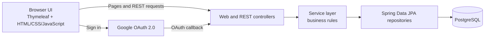

# Expense Tracker

Expense Tracker is a web application for recording personal expenses, organizing them by category, and viewing spending summaries. It uses a layered Spring Boot backend, a browser-based frontend, and PostgreSQL for persistent storage.

## Architecture

### Backend layers

- **Controllers** expose the web page and REST API. Expense endpoints are under `/api/expense`; categories and authentication are under `/api/categories` and `/api/auth`.
- **Services** implement application rules such as validating date ranges, resolving categories, and restricting expense operations to the authenticated user.
- **Repositories** use Spring Data JPA to query and persist users, categories, and expenses.
- **Entities and DTOs** represent database records and the request/response shapes used by the API.
- **Security/configuration** contains Spring Security setup, JWT handling, Google OAuth login, password encoding, and OpenAPI configuration. The health endpoint is `GET /api/health`.
- **Exception handling** maps application errors into API responses.

### Authentication

Users can register and sign in with email/password or use Google OAuth 2.0. After either login flow, the frontend uses a signed JWT as a bearer token for protected API requests. Google OAuth uses a temporary server-side session for the authorization handshake; the application API itself is authenticated with JWTs. Expense data is queried in the context of the authenticated user's email.

### Frontend

Spring MVC serves the main page from `src/main/resources/templates/index.html`. The page uses the JavaScript in `src/main/resources/static/js/app.js` to call the REST API and render the dashboard, expense list, and sign-in experience. Styles are in `src/main/resources/static/css/app.css`.

### Database and runtime

PostgreSQL stores application data. Flyway applies schema and seed-data migrations from `src/main/resources/db/migration`; Hibernate validates the schema at startup. `compose.yaml` defines the application and PostgreSQL services, and the app waits for the database health check before starting.

## Main technologies

- Java 21 and Spring Boot
- Spring MVC, Spring Security, Spring Data JPA, and Hibernate
- JWT and Google OAuth 2.0
- PostgreSQL and Flyway
- Thymeleaf, HTML, CSS, and JavaScript
- Docker Compose

## API documentation and health check

When the application is running:

- Swagger UI: `http://localhost:8080/swagger-ui.html`
- OpenAPI JSON: `http://localhost:8080/api-docs`
- Health check: `http://localhost:8080/api/health`
